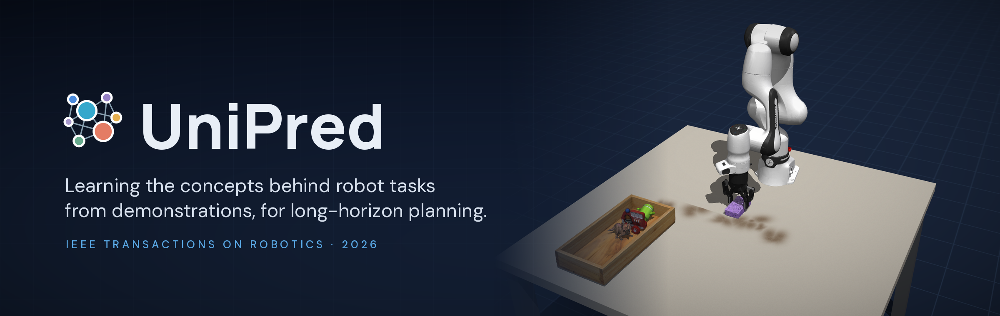
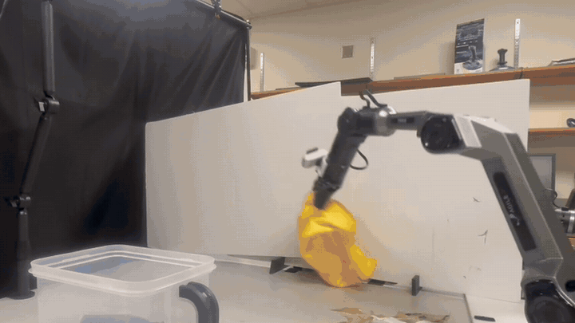

<p align="center">
  
</p>

<p align="center">
  <b>Unifying Deep Predicate Invention with Pre-trained Foundation Models</b><br>
  <a href="https://doi.org/10.1109/TRO.2026.3742972">IEEE T-RO 2026</a> ·
  <a href="https://arxiv.org/abs/2512.17992">arXiv</a> ·
  <a href="https://unipred.github.io/">Project page</a> ·
  <a href="#citation">Citation</a>
</p>

<p align="center">
  
</p>

UniPred learns a symbolic world model for long-horizon planning from a few
demonstrations. A large language model proposes what each predicate means
(which skills make it true or false), neural classifiers learn the
predicates from the robot's own observations, and the classifiers'
training feedback tells the language model how to revise its proposals.
Predicates defined with quantifiers ("no toy is on the table") come from
derived-aware predicate selection, and in image domains the classifiers
work on foundation-model features of object crops. The robot then plans
with the learned predicates and operators over its skill library, and
replans whenever what it observes differs from what it expected.

This repository has:

- **UniPred**, its ablations and every baseline of the paper (IVNTR, GNN
  and transformer policies, grammar search, Code as Policy, ViLa,
  Pix2Pred), on the simulated domains Satellites, Blocks, Packing and
  Table Clean;
- **a simulated robot** (a Franka in MuJoCo) for the paper's two
  real-world tasks, Table Clean and Cluttered Retrieval: record
  demonstrations, learn from camera images, and run the closed loop with
  an annotated video of what the robot sees, believes and does;
- **a real-robot template** that turns your own recordings into a model
  you deploy in a closed loop on your robot.

## Contents

- [Install](#install)
- [Quickstart](#quickstart)
- [The simulated robot](#the-simulated-robot)
- [Your own robot](#your-own-robot)
- [Domains and methods](#domains-and-methods)
- [Reproducing the paper's tables](#reproducing-the-papers-tables)
- [Repository layout](#repository-layout)
- [Citation](#citation)

## Install

Linux, Python 3.10, conda, cmake and a C++ compiler (for Fast Downward),
and a CUDA GPU for the image domains.

```bash
git clone --recurse-submodules https://github.com/weiqianwang123/UniPred.git
cd UniPred
scripts/install.sh
conda activate unipred
export FD_EXEC_PATH=$PWD/third_party/IVNTR/ext/downward
```

`scripts/install.sh` creates the conda environment `unipred`, installs
UniPred and its IVNTR fork (`third_party/IVNTR`, the `predicators`
package) in editable mode, and builds Fast Downward. Options:

- `--weights` downloads GroundingDINO, SAM2 and DINOv3 into `weights/`
  (set `UNIPRED_WEIGHTS_DIR` to use another directory). DINOv3 is gated on
  Hugging Face: accept its licence and run `hf auth login` first. Without
  it, image domains use ResNet-18 features.
- `--sim` installs MuJoCo and downloads the simulated robot's assets (the
  Franka, the gripper and the scanned objects) into `sim_assets/`.

**Language models.** `scripts/run.sh` uses the one named by `LLM`:
`openai` (GPT-4o, the paper's), `qwen`, `gemini`, `codex` (a local Codex
CLI), or `mock` (no network; for tests and smoke runs). Put API keys in
`.env.local` (see `.env.example`) or the environment. Replies are cached
in `outputs/llm_cache`, so a rerun costs nothing.

## Quickstart

Learn predicates on Satellites and plan with them, with the offline mock
language model (about 5 minutes):

```bash
LLM=mock scripts/run.sh configs/satellites/unipred.yaml 0 --num_train_tasks 50 --num_test_tasks 10
```

The results are in `outputs/satellites/unipred/seed0/`: `train_test.log`
(learning, then the test tasks, larger than the training ones) and
`test_in_domain.log` (tasks like the training ones). The mock model only
checks that the pipeline runs; use a real one (`LLM=openai`) and the
paper's 500 demonstrations (the config's default) to learn a useful model.

## The simulated robot

<table>
  <tr>
    <td align="center" width="50%"><b>Table Clean</b>: put the toys and the sponge into the tray and wipe the table. The tray blocks the dirt when near; the sponge is out of reach when the tray is pushed out.</td>
    <td align="center" width="50%"><b>Cluttered Retrieval</b>: put the snack bars into the basket. A target hidden behind a bottle or a box cannot be grasped until the obstacle is removed or pushed aside.</td>
  </tr>
</table>

A Franka with a Robotiq gripper performs both tasks in MuJoCo with
scripted skills; the constraints are physical, not rules. UniPred learns
from the camera images only: objects are segmented with SAM3, followed
between keyframes with its video tracker, and encoded by DINOv3 (or
ResNet-18). The pipeline is the real robot's.

**1. Start a SAM3 server** (in an environment of its own; SAM3 is gated
on Hugging Face):

```bash
pip install "sam3 @ git+https://github.com/facebookresearch/sam3" fastapi uvicorn huggingface_hub
python scripts/sam3_server.py --port 8114
```

**2. Record demonstrations and test scenes** (oracle plans executed skill
by skill, with keyframes, the frames of every skill and ground-truth
annotations):

```bash
python examples/real_robot/collect_sim_demos.py --domain table_clean --out outputs/table_clean_mujoco/raw --num_train 50 --num_test 10
```

**3. Turn the images into object features:**

```bash
python examples/real_robot/process_demos.py --raw outputs/table_clean_mujoco/raw --out outputs/table_clean_mujoco/processed \
    --domain configs/table_clean_real/domain.yaml --robot_config configs/sim_robot.yaml --encoder resnet18
```

**4. Learn the predicates and operators:**

```bash
scripts/run.sh configs/table_clean_real/unipred.yaml 0 --table_clean_real_data_dir outputs/table_clean_mujoco/processed \
    --num_train_tasks 50 --num_test_tasks 10
```

**5. Run the closed loop on a test scene**, with an annotated video:

```bash
python examples/real_robot/closed_loop_example.py --session outputs/table_clean_mujoco/raw/test_00 --robot sim \
    --robot_config configs/sim_robot.yaml --encoder resnet18 --first_boxes gt_boxes.json --video test_00.mp4 \
    --config configs/table_clean_real/unipred.yaml --config configs/llm/mock.yaml --seed 0 --num_train_tasks 50 --num_test_tasks 10 \
    --table_clean_real_data_dir outputs/table_clean_mujoco/processed --approach_dir outputs/table_clean_real/unipred/seed0/approach
```

The loop perceives the scene, plans, executes a skill, perceives again,
and replans when the skill's expected effects did not happen; the video
shows the camera, the plan and the atoms the robot believes, with each
invented predicate named after the ground-truth predicate it matches.
For Cluttered Retrieval, use `--domain cluttered_retrieval`,
`configs/cluttered_retrieval_real/` and
`configs/sim_robot_cluttered_retrieval.yaml`. See
[docs/real_robot.md](docs/real_robot.md) for the scenes, the skills and
the perception.

## Your own robot

Record sessions in the raw format of
[examples/real_robot/README.md](examples/real_robot/README.md) (a
keyframe image before each skill, the skills, the goal), process and
learn as above, then implement `RobotInterface`: `capture()` returns a
camera image and `execute(option_name, objects)` runs your skill on the
named objects. `examples/real_robot/fixture` is a small synthetic dataset
to try every step without a robot or network weights.

## Domains and methods

| Domain | Config | Observations | Train → test |
|---|---|---|---|
| Satellites | `configs/satellites` | object poses and attributes | 2 → 3 satellites and objects |
| Blocks | `configs/blocks` | 3D poses | towers of 4-5 → 6-7 blocks |
| Packing | `configs/packing` | poses and image crop features | 2 → 3 boxes with movable dividers |
| Table Clean Sim | `configs/table_clean_sim` | poses and flags | 2 → 3 toys |
| Table Clean | `configs/table_clean_real` | camera images | recordings (real or simulated) |
| Cluttered Retrieval | `configs/cluttered_retrieval_real` | camera images | recordings (real or simulated) |

Each domain has a config per method: `unipred`, `ivntr`, `oracle`, `gnn`,
`transformer`, `grammar`, `random`, `code_as_policy`, and `ivntr_derived`,
`vila_*` and `pix2pred*` where they apply. Run any of them with
`scripts/run.sh CONFIG SEED [FLAGS...]`; ablations are overlays:

```bash
scripts/run.sh configs/table_clean_sim/unipred.yaml 0 --config configs/ablations/no_derived_selection.yaml
```

See [docs/domains.md](docs/domains.md) for the domains and
[docs/adding_a_domain.md](docs/adding_a_domain.md) to add one.

## Reproducing the paper's tables

Each script runs its experiments for five seeds (`SEEDS="0 1 2 3 4"`),
skips the seeds that already have results, and prints the table; `RUN=0`
only prints it.

| Table | Script | Experiments |
|---|---|---|
| II | `scripts/paper/table2.sh` | every method on the simulated domains; UniPred with Qwen and Gemini |
| V | `scripts/paper/table5.sh` | without PDDL completion, the LLM loop or the loss feedback |
| VI | `scripts/paper/table6.sh` | LLM-completed PDDL and Code as Policy on Blocks |
| VII | `scripts/paper/table7.sh` | without semantic names; IVNTR |
| VIII | `scripts/paper/table8.sh` | derived-aware selection on Table Clean Sim |

The Tools domain of the paper is not part of this release. `python -m
unipred.eval.summarize --domains ... --runs ...` prints a table from any
runs.

## Repository layout

```
unipred/            the UniPred package
  approaches/         UniPred and the language-model baselines
  llm/                PDDL completion, effect proposals, prompts, clients
  derived/            derived predicates and derived-aware selection
  envs/               Packing, Table Clean Sim, Cluttered Retrieval Sim, recorded domains
  perception/         detection, tracking and crop features
  robot_sim/          the simulated Franka and its two scenes
third_party/IVNTR/  the fork of IVNTR (predicate invention, planning)
configs/            a directory per domain, LLM and ablation overlays
examples/real_robot/ recording, processing, planning from images, the closed loop
scripts/            install, run, the paper's tables, the SAM3 server
docs/               architecture, domains, real robot, adding a domain
```

[docs/architecture.md](docs/architecture.md) describes how UniPred and
the fork fit together. Tests: `pytest tests` and `cd third_party/IVNTR &&
pytest tests`.

## Citation

```bibtex
@article{wang2026unipred,
  title={Unifying Deep Predicate Invention With Pre-Trained Foundation Models},
  author={Wang, Qianwei and Li, Bowen and Luo, Zhanpeng and Xu, Yifan and Kamat, Vineet and Menassa, Carol and Gray, Alexander and Silver, Tom and Scherer, Sebastian and Sycara, Katia and Xie, Yaqi},
  journal={IEEE Transactions on Robotics},
  year={2026},
  pages={1--20},
  doi={10.1109/TRO.2026.3742972}
}
```

UniPred is released under the MIT license. It builds on
[IVNTR](https://github.com/centaur-ai/IVNTR) and
[predicators](https://github.com/Learning-and-Intelligent-Systems/predicators);
see [THIRD_PARTY_NOTICES.md](THIRD_PARTY_NOTICES.md) for the licenses of
the included and downloaded components.
