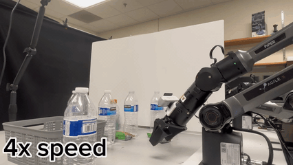
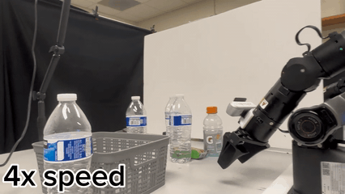
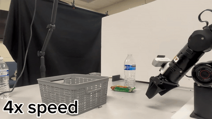

<p align="center">
  
</p>

<h1 align="center">UniPred</h1>

<p align="center">
  <b>Unifying Deep Predicate Invention with Pre-trained Foundation Models</b><br>
  <a href="https://arxiv.org/abs/2512.17992">Paper</a> ·
  <a href="https://unipred.github.io/">Project page</a>
</p>

UniPred learns a symbolic world model for long-horizon planning from a few
demonstrations: a large language model proposes what predicates mean (their
effects on the robot's skills), neural classifiers learn them from the
robot's own data, and the training loss tells the language model how to
revise its proposals. Predicates defined by quantifiers ("no toy is on the
table") are handled by derived-aware predicate selection, and in image
domains the classifiers work on DINOv3 features of object crops.

This repository has the code of the paper: UniPred, its ablations and every
baseline, on the four simulated domains (Satellites, Blocks, Packing, Table
Clean Sim), and a real-robot template (Table Clean Real) that turns your
own recordings into a model you can deploy in a closed loop.

- [Install](#install)
- [Quickstart](#quickstart)
- [Domains](#domains)
- [Reproducing the paper's tables](#reproducing-the-papers-tables)
- [Real-robot template](#real-robot-template)
- [Adding a domain](#adding-a-domain)
- [Repository layout and tests](#repository-layout-and-tests)
- [Citation](#citation)

## Demo Videos

### Main Demo

<p align="center">
  
</p>

<p align="center">
  <b>UniPred performs long horizon planning with a learned neural-symbolic world model.</b>
</p>

### Demos for Other Tasks

<table>
  <tr>
    <td align="center" width="50%">
      <br>
      <b>Table Clean</b><br>
      Train Task
    </td>
    <td align="center" width="50%">
      <br>
      <b>Table Clean</b><br>
      Test Task
    </td>
  </tr>
</table>

<table>
  <tr>
    <td align="center" width="33%">
      <br>
      <b>Pick Target in Clutter</b><br>
      Test Task
    </td>
    <td align="center" width="33%">
      <br>
      <b>Pick Target in Clutter</b><br>
      Test Task
    </td>
    <td align="center" width="33%">
      <br>
      <b>Pick Target in Clutter</b><br>
      Train Task
    </td>
  </tr>
</table>

### Failure Recovery

<p align="center">
  
</p>

<p align="center">
  <b>UniPred replans from observation feedback and recovers from execution failures.</b><br>
  Across 13 execution steps, the system detects action failures, replans, and completes the task.
</p>

<p align="center">
  
  
</p>

### Remaining Failure Cases

<p align="center">
  
  
  
</p>

<p align="center">
  <b>Long horizon manipulation remains challenging.</b><br>
  Planning errors and accumulated execution errors can still cause failures over extended task horizons.
</p>

## Install

Linux, Python 3.10, a CUDA GPU for the image domains (classifier training
is small), conda, and cmake with a C++ compiler for Fast Downward.

```bash
git clone --branch refactor/paper-release --recurse-submodules https://github.com/weiqianwang123/UniPred.git
cd UniPred
scripts/install.sh
conda activate unipred
export FD_EXEC_PATH=$PWD/third_party/IVNTR/ext/downward
```

`scripts/install.sh` creates the conda environment `unipred`, installs the
IVNTR fork and UniPred in editable mode (`pip install -e third_party/IVNTR
&& pip install -e ".[dev,perception]"`) and builds Fast Downward.
`scripts/install.sh --weights` also downloads GroundingDINO, SAM2 and
DINOv3 into `weights/` (or `$UNIPRED_WEIGHTS_DIR`); set
`UNIPRED_WEIGHTS_DIR` to that directory when running. DINOv3 is gated on
Hugging Face: accept its licence and log in (`hf auth login`) first. Without
DINOv3, Packing uses ResNet-18 features.

**LLMs.** `scripts/run.sh` uses the LLM named by `LLM`: `codex` (the local
Codex CLI; the default when it is installed), `openai` (GPT-4o, the
paper's; the default otherwise), `qwen`, `gemini`, or `mock` (no network;
tests and smoke runs). Put API keys in `.env.local` (see `.env.example`) or
the environment. Replies are cached in `outputs/llm_cache`, so reruns are
free.

## Quickstart

Train UniPred on Satellites and test it, with the offline mock LLM and 50
demonstrations:

```bash
LLM=mock scripts/run.sh configs/satellites/unipred.yaml 0 --num_train_tasks 50 --num_test_tasks 10
```

Results are in `outputs/satellites/unipred/seed0/` (`train_test.log`, the
out-of-distribution test; `test_in_domain.log`, the test on tasks from the
training distribution with the saved model). The mock LLM only checks that
the whole pipeline runs (about 5 minutes): its proposals are placeholders,
so the learned model solves few or no test tasks. Drop `LLM=mock` and the
task counts for the paper's setting (a real LLM, 500 demonstrations, 50
test tasks).

## Domains

| Domain | Config directory | State | Notes |
|---|---|---|---|
| Satellites | `configs/satellites` | poses and attributes | 2 → 3 satellites and objects |
| Blocks | `configs/blocks` | 3D poses | two-level towers, 4-5 → 6-7 blocks |
| Packing | `configs/packing` | poses + image crop features | movable dividers; fit is visible only in images |
| Table Clean Sim | `configs/table_clean_sim` | poses and flags | derived predicate "no toy on the table" |
| Table Clean Real | `configs/table_clean_real` | image crop features | built from recordings, offline evaluation |

Each domain has a config per approach: `unipred`, `ivntr`, `oracle`, `gnn`,
`transformer`, `grammar`, `random`, `code_as_policy` (and `ivntr_derived`,
`vila_*`, `pix2pred*` where they apply). See [docs/domains.md](docs/domains.md).

Run any of them with `scripts/run.sh CONFIG SEED [FLAGS...]`; ablations are
overlays:

```bash
scripts/run.sh configs/table_clean_sim/unipred.yaml 0 --config configs/ablations/no_derived_selection.yaml
```

writes to `outputs/table_clean_sim/unipred+no_derived_selection/seed0/`.

## Reproducing the paper's tables

Each script runs its experiments for five seeds (`SEEDS="0 1 2 3 4"`),
skips seeds that already have results, and prints the table; `RUN=0` only
prints it from existing results.

| Table | Script | Experiments |
|---|---|---|
| II | `scripts/paper/table2.sh` | every method on the four simulated domains, UniPred with Qwen and Gemini |
| III | see [docs/real_robot.md](docs/real_robot.md) | UniPred, IVNTR w/ derived, ViLa, Pix2Pred on Table Clean Real |
| V | `scripts/paper/table5.sh` | UniPred without PDDL completion, without the LLM loop, without loss feedback |
| VI | `scripts/paper/table6.sh` | LLM-completed PDDL and Code as Policy in Blocks |
| VII | `scripts/paper/table7.sh` | UniPred without semantic names, and IVNTR |
| VIII | `scripts/paper/table8.sh` | derived-aware selection in Table Clean Sim |

The Tools domain of the paper is not part of this release, so tables that
average over domains use the remaining ones; Table IV needs the robot.
`python -m unipred.eval.summarize --domains ... --runs ...` prints a table
from any runs.

## Real-robot template

```bash
python examples/real_robot/process_demos.py --raw examples/real_robot/fixture/raw --out outputs/table_clean_real/processed --domain configs/table_clean_real/domain.yaml --detector fake --encoder fake
LLM=mock scripts/run.sh configs/table_clean_real/unipred.yaml 0 --num_train_tasks 4 --num_test_tasks 2
```

process the synthetic recordings shipped in `examples/real_robot/fixture`
and invent predicates on them. Record your own sessions in the same format,
drop the `fake` backends, then plan from images and run the closed loop
through a `RobotInterface` you implement. See
[examples/real_robot/README.md](examples/real_robot/README.md) and
[docs/real_robot.md](docs/real_robot.md).

## Adding a domain

A simulated domain is an environment class, its ground-truth options and
operators, and a config directory; a real domain is a config directory and
a ground-truth package. See [docs/adding_a_domain.md](docs/adding_a_domain.md).

## Repository layout and tests

`unipred/` is the UniPred package and `third_party/IVNTR` the fork of IVNTR
(the `predicators` package) it builds on; [docs/architecture.md](docs/architecture.md)
describes both and how they connect.

```bash
pytest tests
cd third_party/IVNTR && pytest tests
```

## Citation

```bibtex
@article{wang2025unipred,
  title={Unifying Deep Predicate Invention with Pre-trained Foundation Models},
  author={Wang, Qianwei and Li, Bowen and Luo, Zhanpeng and Xu, Yifan and Kamat, Vineet and Menassa, Carol and Gray, Alexander and Silver, Tom and Scherer, Sebastian and Sycara, Katia and Xie, Yaqi},
  journal={arXiv preprint arXiv:2512.17992},
  year={2025}
}
```

UniPred is MIT-licensed; see [THIRD_PARTY_NOTICES.md](THIRD_PARTY_NOTICES.md)
for the licenses of the included and downloaded third-party components.
